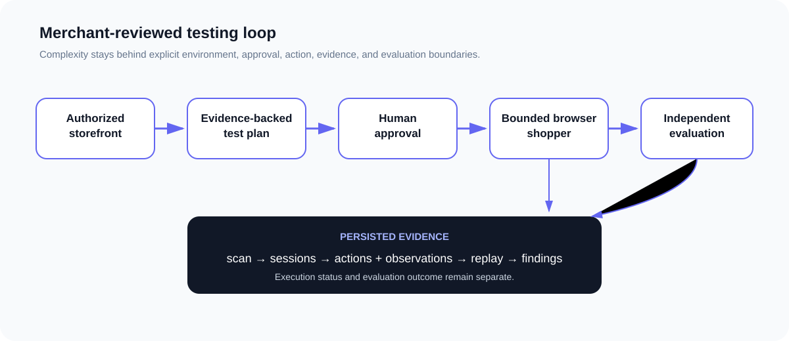

# Glasswing Gateway

An applied AI prototype for testing how autonomous shoppers behave on an authorized storefront. A merchant reviews the proposed shopping goals, approves execution, then inspects browser traces, evaluation results, and findings.

Gateway began as a collaborative project at the Glasswing Ventures AI Hackathon in Boston, September 26–27, 2026. This portfolio edition includes later engineering hardening. It does not represent the exact judged submission or a production service.

## The problem

A storefront can work for a person while confusing a browser agent. Product evidence may be incomplete, a shopper can miss a budget constraint, and a model's claim of success can disagree with what happened in the browser.

Gateway makes those differences inspectable. Its central distinction is between execution status and task outcome: a session can finish running and still fail its shopping goal.

## Implemented workflow

1. Select a server-configured, authorized test environment.
2. Inspect a bounded set of storefront pages.
3. Review and edit proposed shopper archetypes and scenarios.
4. Approve the plan. Editing it invalidates approval.
5. Execute bounded Playwright browser sessions.
6. Evaluate observed behavior with deterministic checks and a separate evaluator.
7. Inspect replay events, observations, available screenshot frames, usage, and findings.

The default workflow stops at a recommendation or decline. An optional, explicitly configured adapter can test cart addition and checkout navigation on safe staging stores. This repository does not claim completed purchases, production payment safety, automatic merchant fixes, or production tenant isolation.

## Architecture and stack



| Component           | Implementation                                           | Responsibility                                                    |
| ------------------- | -------------------------------------------------------- | ----------------------------------------------------------------- |
| Merchant interface  | Next.js 15, React 19, TypeScript, Tailwind CSS, Radix UI | Inspect, review, approve, run, and investigate                    |
| Account boundary    | Supabase Auth and a PostgreSQL profile migration         | Verify sessions; limit profile access to its owner                |
| Workflow service    | `lib/gateway/service.ts`, Zod schemas                    | Validate drafts, approval, policy, and state transitions          |
| Browser runner      | Playwright in `lib/gateway/browser.ts`                   | Observe pages and execute permitted actions                       |
| Model adapter       | OpenAI Responses API or explicit fixtures                | Propose plans/actions and evaluate semantic outcomes              |
| Evaluation          | `lib/gateway/evaluate.ts`                                | Keep deterministic checks separate from semantic assessment       |
| Persistence         | Owner-scoped JSON files in `.gateway-data/`              | Store drafts, scans, sessions, traces, and frames                 |
| Execution admission | `lib/gateway/budget.ts`                                  | Persist quotas and reserve cost before model attempts             |
| Verification        | Playwright backend, UI bridge, and opt-in live tests     | Check domain behavior, browser boundaries, and application wiring |

Data flows from merchant input through server-side validation and approval into browser observations, then into evaluation and persisted findings. Models propose actions; server policy determines what can execute. The evaluator receives scenario and browser evidence without the shopper conversation, success claims, or expected outcome. A semantic pass cannot override a deterministic failure.

The supported prototype runtime is one persistent Node process with shared local storage. It is not a distributed worker system or an ephemeral serverless application. See the [API and execution contract](docs/gateway-api.md).

## AI behavior and evidence limits

`GATEWAY_MODEL_MODE=openai` uses configured server-side model names and an API key. Live execution also requires an allowed owner UUID, conservative model-pricing bounds, and positive spend limits. Missing credentials never silently enable fixtures.

`GATEWAY_MODEL_MODE=fixture` selects deterministic model outputs explicitly. The fixture UI bridge uses a synthetic identity server and a local storefront; it exercises the real application and browser runner. Fixture passes establish application behavior, not model quality, real Supabase acceptance, or merchant outcomes.

The retained `/api/buyers` route is a separate authenticated, budgeted legacy model/tool workflow. It can use operator-configured OpenAI-compatible endpoints; some tools and reported outcomes are synthetic or shopper self-reported. It is not the connected workflow's independent evaluation. Endpoint overrides receive their configured server-side credential and conversation content.

Legacy Security, Analytics, Integrations, Settings, Demand Signal, and demonstration replays retain labeled fixture/configuration data. Integration cards do not establish working provider integrations. Cost and ROI views distinguish recorded usage from pricing and manual-QA assumptions.

## My engineering contributions

I am Ajanee Igharo. My work on the collaborative hackathon project focused on authentication/security, UX/UI, regression checks, and demo coordination. I worked on the merchant journey from discovery and scenario review through replay evidence, findings, and retesting.

[Merged team PR #6](https://github.com/nnt-git13/GlasswingHackathon/pull/6) is the principal integration record for my investigation/replay UX contribution. The separate [auth/session-protection PR #17](https://github.com/nnt-git13/GlasswingHackathon/pull/17) documents additional work; it should not be described as merged hackathon functionality solely because similar controls exist in this later edition.

I subsequently prepared this portfolio edition through an AI-assisted engineering workflow: reviewing implementation evidence, coordinating authentication and execution-boundary hardening, running verification, replacing assets with documented sources, and separating prototype behavior from unverified claims. Later hardening belongs to the post-hackathon release work. This is not a claim that I independently authored every component or built the entire system during the event.

The source makes the engineering decisions inspectable: approval invalidation, owner-scoped storage, network/action constraints, independent evaluation, durable spend admission, and regression checks. See [contributions and source provenance](docs/contributions.md).

## Team acknowledgments

Gateway was developed collaboratively. The original Git records credit Nathan / Nathan Nebyou Teshome (`nnt-git13`), Andrew / `andrewdclark11`, LeulTe (`LeulTe`), and Ajanee Igharo (`AjaneeI`). These are contributor display names and GitHub handles, not an independently verified legal-identity roster.

The [original team repository](https://github.com/nnt-git13/GlasswingHackathon) preserves upstream collaboration. This edition begins with a fresh snapshot history; resetting history does not change the origin or ownership of the code. Teammate support for publication is recorded through the maintainer's confirmation.

## Install and run locally

Use Node.js 22 and npm to match the repository verification workflow.

```bash
npm ci --ignore-scripts
npx playwright install chromium
cp .env.example .env.local
```

Configure a Supabase project and apply the migration using the [account setup instructions](supabase/README.md). Keep email confirmation enabled. Set the canonical app URL and allowlist its auth callback. Use a publishable key, never a service-role/secret key in `NEXT_PUBLIC_` values.

```bash
npm run dev -- --hostname 127.0.0.1
```

Open `http://localhost:3000`. Without Supabase configuration, protected workspace routes and APIs reject access. The public landing, login/signup, and Discover shell do not create a substitute session. Stop the local server when finished.

For a local production build:

```bash
npm run build
npm run start -- --hostname 127.0.0.1
```

No hosted deployment is included.

## Configuration

| Setting                                                            | Requirement                                                                                |
| ------------------------------------------------------------------ | ------------------------------------------------------------------------------------------ |
| `NEXT_PUBLIC_SUPABASE_URL`, `NEXT_PUBLIC_SUPABASE_PUBLISHABLE_KEY` | Your own Supabase project URL and publishable key                                          |
| `NEXT_PUBLIC_SITE_URL`                                             | Canonical local URL, also configured in Supabase redirects                                 |
| `GATEWAY_MODEL_MODE`                                               | Explicit `fixture` or `openai`; fixture mode does not bypass authentication                |
| `OPENAI_API_KEY`                                                   | Server-only; required for live models, omitted for fixtures                                |
| `GATEWAY_TEST_ENVIRONMENTS`                                        | Exact authorized origins, allowed read paths/query keys, and optional safe staging adapter |
| `GATEWAY_LIVE_OWNER_IDS`, pricing and USD caps                     | Required admission configuration for live execution; see `.env.example`                    |
| `GATEWAY_DATA_DIR`                                                 | Persistent private data directory; defaults to `.gateway-data/`                            |

Copy values from `.env.example` into your untracked `.env.local`. Do not commit account credentials, browser storage states, traces, or private results. The supplied public-storefront policy examples are reference configurations, not a grant of permission to automate a third-party site. Use storefronts you own or are authorized to test.

## Testing

Install Chromium first. The backend and fixture UI bridge start their own local fixtures:

```bash
npm run test:backend
npm run test:bridge
npm run typecheck
npm run build
npm audit --audit-level=moderate
```

To invoke the complete test suite, start the app in one terminal, then run:

```bash
GATEWAY_TEST_URL=http://localhost:3000 npm run test:e2e
```

The full invocation includes intentionally gated tests. Authenticated workspace tests require `GATEWAY_TEST_STORAGE_STATE`; live account tests require a confirmed Supabase test account. Storefront, screenshot-capture, and paid-model tests are explicit opt-ins. Do not interpret skips as successful live verification. See [test modes and prerequisites](docs/testing.md).

## Security considerations

Protected operations verify the Supabase user and scope stored resources to their owner. Responses containing account/workspace data use private, no-store caching. Server controls bound request bodies, origins, paths, browser actions, redirects, response sizes, execution quotas, and spend reservations. Cart writes require a matching one-use grant.

Those controls depend on a trusted operator configuring safe endpoint semantics and conservative pricing, a persistent data directory, and one Node process. Storefront content and model output remain untrusted. Use staging systems; keep the app on loopback during local review. See [security boundaries and limitations](docs/security.md).

## Known limitations

- Hosted Supabase migration state, RLS behavior, confirmation delivery, and real-account acceptance are not verified by the fixture suite.
- Live model availability, quality, cost accuracy, and end-to-end merchant outcomes are unverified for this release candidate.
- Storage, locking, retention, and interrupted-run recovery require a persistent single-process operator workflow.
- Screenshot frames are optional snapshots rather than continuous video. No screenshots are distributed in this source edition.
- Google sign-in, SSO, and self-service password recovery are not implemented.
- Legacy demonstration surfaces are retained for context and must not be used as live business measurements.

## Future engineering opportunities

Move persistence and jobs to a service with cross-process concurrency controls; automate safe retention and recovery; add hosted two-user auth/RLS acceptance tests; evaluate shoppers and evaluators on a documented scenario set; improve failure classification and operator observability. Each is future work, not a shipped capability.

## Assets and license status

This edition includes Lucide-derived illustrations, Simple Icons integration marks, and repository-created diagrams. Source and license records are in [asset provenance](docs/asset-provenance.md) and [third-party notices](THIRD_PARTY_NOTICES.md). Historic photographs, embedded unverified brand artwork, and screenshots are excluded. Evertrail Outdoors is fictional; brand names identify services without implying endorsement.

No project-level open-source license has been applied. Contributors retain their rights; public visibility alone would not grant general reuse permission. Third-party components retain their own terms. The original private historical archive and its commits, branches, tags, and pull requests are not included in this fresh-history edition.
